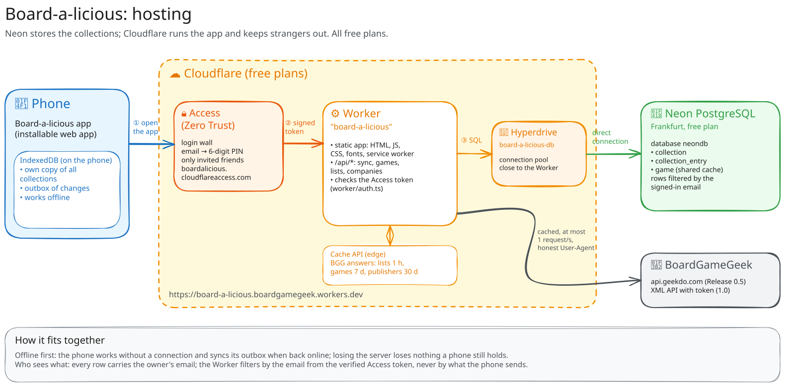

# Hosting: Neon and Cloudflare

What runs where and why. How to set it up or change it: [setup.md](setup.md).

## In short

- **Neon** stores everyone's collections on the server: a free, serverless PostgreSQL database
  in Frankfurt. It is what lets a person see their collections on a second phone or after losing
  one. Nothing else lives there.
- **Cloudflare** runs the app and keeps strangers out: one Worker serves the app's pages and its
  small API, Hyperdrive connects that Worker to Neon, and Cloudflare Access lets only invited
  friends in (they sign in with a one-time PIN sent by email). All on free plans.

Decisions behind this: [ADR 0002](../adr/0002-single-cloudflare-worker.md) (one Worker),
[ADR 0003](../adr/0003-access-control-cloudflare-access.md) (Access),
[ADR 0004](../adr/0004-storage-neon-local-first.md) (Neon, local-first).

## How a request travels



Editable drawing: [hosting.excalidraw](hosting.excalidraw) (open at excalidraw.com or with the
VS Code Excalidraw extension; after editing, export it again as `hosting.svg`).

```text
phone ──► Cloudflare Access ──► Worker "board-a-licious" ──► Hyperdrive ──► Neon (Frankfurt)
          (PIN login,            ├─ static app (HTML, JS,                   collections,
           checks the email)     │  CSS, fonts, service worker)             entries, game cache
                                 └─ /api/* ──────────────────► BoardGameGeek (cached, 1 request/s)
```

The phone keeps its own copy of everything in IndexedDB and works offline; the server copy is for
sync between devices and as a backup. Losing the server would lose nothing a phone still holds.

## Neon

| What | Value |
|---|---|
| Project | `Board-a-licious`, region AWS Europe Central 1 (Frankfurt), free plan |
| Database | `neondb`, role `neondb_owner` |
| Schema | `migrations/*.sql`: tables `collection`, `collection_entry`, `game` (0001) `loaded_list` (0002, which BGG lists a person loaded) and `synced_at` on all three (0003, the server's receive time, used for pulls) |
| Connection | the **direct** connection string (host without `-pooler`), stored only in Hyperdrive |

- **Free plan**: 1 GB storage (the app needs a few MB), scales to zero when idle. The first
  request after a quiet period takes a moment longer while the database wakes up.
- **Who sees what**: every row carries the owner's email; the Worker filters every query by the
  email from the verified Access login, never by anything the phone sends.

## Cloudflare

| Part | What it does here | Where it is configured |
|---|---|---|
| **Worker** `board-a-licious` | serves the built app (static assets) and `/api/*` | `wrangler.jsonc`, deployed with `npm run deploy` |
| **workers.dev address** | `https://board-a-licious.boardgamegeek.workers.dev` | account subdomain `boardgamegeek` |
| **Hyperdrive** `board-a-licious-db` | keeps a pool of connections to Neon close to the Worker; the Worker connects through binding `HYPERDRIVE` | ID `fe856b6ea9814a788872db3a9ff9ef89` in `wrangler.jsonc` |
| **Cache API** | caches BGG answers at the edge (lists 1 h, games 7 days, publishers 30 days) | in code, `worker/bgg/cache.ts` |
| **Zero Trust / Access** | login wall in front of the whole address; only listed emails get a one-time PIN | Zero Trust dashboard; team domain and AUD tag in `wrangler.jsonc` vars |

- **The Worker in the dashboard** (Workers & Pages → `board-a-licious` → Overview) is drawn as a
  flow from left to right:
  - **Domains**: the addresses that lead to the Worker. Here only the `workers.dev` address;
    *custom domains* (an own domain like `app.example.com`) and *routes* (paths on a domain you
    own) are unused.
  - **The Worker** in the middle, with **Observability**: *Workers Logs* (stored `console`
    output and errors) and *Workers Traces* (timing of each request). Both are off; they help
    when something breaks in production and can be switched on in `wrangler.jsonc`.
  - **Bindings**: what the Worker may use besides the internet. Here one: `HYPERDRIVE`, the
    connection to the Neon database (`board-a-licious-db`).
  - The tabs above (**Access**, **Settings**, …) hold the rest, e.g. the login wall for the
    `workers.dev` address.
- **What "Zero Trust" means**: Cloudflare's name for its products that decide who may reach what,
  trusting no one by default: every request must prove who sent it (unlike a classic company
  network, where being inside is enough). Of it the app uses only **Access**, a login wall in front
  of its address: a visitor enters their email; if it is on the list, Cloudflare emails a 6-digit
  one-time PIN (a new one on every login, valid for a few minutes); with the PIN they get in,
  everyone else never reaches the app. The Zero Trust "team" is the account for this area; its
  name is the login page's address (`boardalicious.cloudflareaccess.com`).
- **Access and the Worker**: Access puts a signed token (`Cf-Access-Jwt-Assertion`) on every
  request it lets through. The Worker checks that token's signature, issuer (the team domain) and
  audience (the application's AUD tag) in `worker/auth.ts`, so even a request that bypassed Access
  gets no data.
- **Access settings in use**: application session duration 1 month (one PIN per person per
  month); login method One-time PIN only, with *instant authentication* on, so the email field
  comes straight away; MFA, purpose justification and temporary authentication off. Policies:
  "Cloudflare account members" (the owner) and "Friends" (a list of emails), both Allow.
- **When a session expires**: the app still opens from the phone and keeps working; it shows
  "Sign in again", which leads to `/api/signin`. That path is not served by the service worker,
  so it reaches Access, which asks for a new PIN and then sends the person back to the app; the
  outbox syncs afterwards.
- **Locally** there is no Access: `.dev.vars` sets `ENVIRONMENT=development` and `DEV_USER_EMAIL`,
  and `npm run db:local` stands in for Neon.
- **Secrets**: none are committed. The Neon password lives only in Hyperdrive. The BGG token for
  Release 1.0 will be a Worker secret.
- **Free-plan limits** that matter: Workers 100,000 requests a day; Access 50 users; Hyperdrive
  included. A group of friends at a fair stays far below them.
