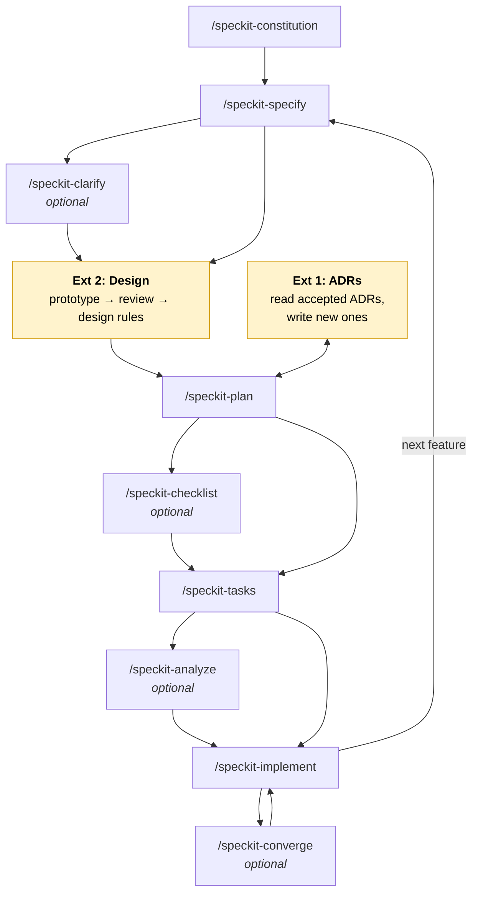

# Spec Kit extended

Our version of Spec Kit: the [basic flow](speckit.md) plus three extensions that fill gaps the basic
flow leaves open.

| # | Extension | Gap in basic Spec Kit | Adds |
|---|---|---|---|
| 1 | Architecture Decision Records | Technical decisions live only in one feature's `research.md`; later features lose the reasons | `docs/adr/` |
| 2 | Design | Nothing defines how the app looks; the implementing agent decides on its own | clickable prototype, `docs/design.md`, `specs/<NNN>/design.md` |
| 3 | Several features ahead | The basic flow assumes one feature at a time; specifying ahead on several branches breaks its folder-based numbering | one worktree per feature, numbering across branches |

## The extended flow



All other steps of the basic flow appear unchanged; the three levels and the task phases stay as
described in [speckit.md](speckit.md).

## Extension 1: Architecture Decision Records

**Purpose**: decisions that outlive one feature are written down once, with reasons and rejected
alternatives, and every later plan has to respect them.

**Artifacts**: `docs/adr/NNNN-<title>.md` (template and rules in [docs/adr/README.md](adr/README.md)).

**Where it plugs in**: `/speckit-plan`, before and after research.

| When | What happens |
|---|---|
| Before research | Read all **Accepted** ADRs. Decisions they cover are not re-researched; the plan's Technical Context links them. |
| During research | For each decision in `research.md`, ask: does it bind later features too (hosting, storage, auth, integrations, core libraries, cross-cutting patterns)? If yes, write an ADR with status **Proposed** and link it from `research.md`. |
| Contradiction | A plan that needs to break an accepted ADR writes a new ADR that **supersedes** it, and says so in the plan's Complexity Tracking. |
| Approval | The user accepts or rejects proposed ADRs before `/speckit-tasks`; accepted ones switch to **Accepted** and are committed with the plan. |
| `/speckit-analyze` | Also checks spec, plan and tasks against accepted ADRs. |

**Rule of thumb**: feature-local choice → `research.md` only; anything a second feature would
have to know → ADR.

## Extension 2: Design

**Purpose**: the user defines how the app looks and feels before the plan and tasks are written,
so the implementation follows agreed rules instead of the agent's taste.

**Artifacts**:

| File | Scope | Content |
|---|---|---|
| Clickable prototype | per feature, throwaway | `specs/<NNN>/design/prototype.html`: a self-contained HTML page of the feature's screens, opened in a desktop browser and tested with the browser's device mode (phone sizes); optionally published as a private, shareable page |
| `docs/design.md` | whole project, like the constitution for the look | design rules: colours and states, typography, spacing, touch sizes, components, layout patterns, motion, light/dark mode, accessibility rules; versioned like the constitution |
| `specs/<NNN>/design.md` | one feature | screens and flows of the feature, prototype link, which components it uses, new components or rules it introduces |

**Where it plugs in**: after `/speckit-specify` (and `/speckit-clarify`), before `/speckit-plan`.

1. **Prototype**: build a clickable prototype from the spec's user stories, using existing
   `docs/design.md` rules if there are any. No real data or backend; realistic sample content.
2. **Review**: the user opens it in the browser, switches the developer tools to device mode
   (e.g. iPhone or a 360 px Android size), tries the flows and gives feedback; iterate until the
   look and the flows feel right. Changes to *what* the feature does go back into `spec.md`.
3. **Rules**: extract what was agreed into `docs/design.md` (new or amended, with a version bump)
   and write the feature's `specs/<NNN>/design.md`.
4. **Gate**: the user approves both files before `/speckit-plan`.

**Effect on the following steps**:

- `/speckit-plan` builds on `docs/design.md` (no component library or styling approach that
  contradicts it) and lists the feature's screens from `specs/<NNN>/design.md`.
- `/speckit-tasks` references screens and components by the names used in the design files.
- `/speckit-implement` follows `docs/design.md`; the prototype is a reference, not code to copy.
- `/speckit-analyze` also checks that every screen in the feature's `design.md` is covered by tasks.

## Extension 3: Several features ahead

Ideas can be specified (and designed) ahead while another feature is planned or built; plan, tasks
and implement still happen one feature at a time.

**One feature, one branch, one worktree**:

- Every feature `NNN-<short-name>` has its own branch of that name and, when worked on in parallel,
  its own worktree next to the repo: `../board-a-licious-NNN` (any folder works; the branch is what
  counts). Create it from an up-to-date `main`:
  `git worktree add ../board-a-licious-NNN -b NNN-<short-name> main`.
- Each worktree is a normal folder: its files can be opened, read and diffed beside the others.
  `git worktree list` shows them all. Each has its own `.specify/feature.json` (git-ignored) and its
  own agent session; the Spec Kit pane follows the branch.
- Working in one folder and switching branches (`git switch`) is equally valid when only one
  feature is open at a time.

**Numbering across branches** (instead of Spec Kit's folder scan):

A worktree's `specs/` only holds `main`'s features and its own, so the next number comes from all
feature branches, which every worktree shares:

```bash
git branch --list '[0-9][0-9][0-9]-*' --format='%(refname:short)' | sort | tail -1   # highest so far
```

Use the next number after the highest of these and of the folders in `specs/`; `/speckit-specify`
creates the branch and `specs/NNN-<short-name>/` with it.

**Order and merging**:

- Specs only describe what and why, so writing several ahead does no harm; plans depend on the
  code, so `/speckit-plan` starts only from a `main` that contains the features it builds on.
- A finished feature is merged into `main` (pull request), and its worktree removed
  (`git worktree remove ../board-a-licious-NNN`); features still in progress take `main` in with
  `git merge main` before their plan.
- Within one feature, its tasks may be split across parallel agents ([Orca Swarm](orca-swarm.md)),
  each in a worktree of its own branched from the feature branch and merged back into it.

## How the extensions are applied

The extensions are instructions, not new `/speckit-*` commands: `CLAUDE.md` points the agent to
this file, so it applies them when running the basic commands.
