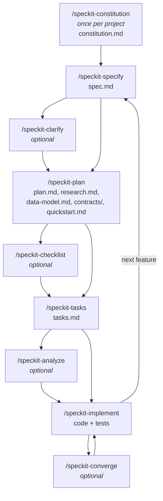
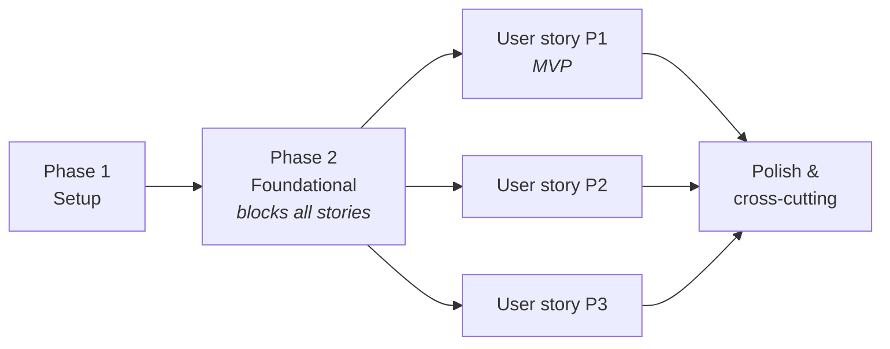

# Spec Kit: the basic flow

Spec Kit is a toolkit for **spec-driven development**: you describe *what* you want and *why* before
anyone decides *how*, and an AI agent turns that description step by step into a plan, tasks and
code. Each step writes a Markdown file that the next step reads, so decisions are written down
instead of living only in a chat.

## The idea in one picture



Solid path: constitution → specify → plan → tasks → implement. The optional steps are quality
gates you can add between them.

## The three levels

| Level | Question it answers | Artifact | Lifetime |
|---|---|---|---|
| Constitution | *How* do we build things here? Principles every feature must respect | `.specify/memory/constitution.md` | whole project, amended rarely |
| Specification | *What* should this feature do for users, and *why*? | `specs/<NNN>-<name>/spec.md` | one feature |
| Plan & tasks | *How* will this feature be built, in which order? | `plan.md`, `tasks.md` and design files in the same folder | one feature |

The spec deliberately contains no technology. Technology choices appear first in the plan, and each
plan is checked against the constitution.

## Getting started

1. **Install** Spec Kit into the repository with `specify init`. This adds the `.specify/` folder
   (templates, scripts, constitution) and the `/speckit-*` commands for the AI agent.
2. **Write the constitution** with `/speckit-constitution <your principles>`. It replaces the
   template's placeholders with your project's rules (e.g. testing, simplicity, accessibility) and
   gives them a version number.

## Working on a feature

| Step | Command | Input | Output |
|---|---|---|---|
| 1 | `/speckit-specify <feature description>` | Plain-language description of what users need | New folder `specs/<NNN>-<name>/` with `spec.md`: prioritised user stories, acceptance scenarios, requirements, success criteria; plus a quality checklist. At most 3 open questions are asked. |
| 2 | `/speckit-clarify` *(optional)* | `spec.md` | Up to 5 targeted questions; answers are written back into the spec |
| 3 | `/speckit-plan <technical direction>` | Spec + constitution | `plan.md` (technical context, constitution check, project structure), `research.md` (decisions with rationale and alternatives), `data-model.md`, `contracts/`, `quickstart.md` |
| 4 | `/speckit-checklist` *(optional)* | Spec + plan | A checklist for a chosen focus (e.g. security, UX) that tests whether the *requirements* are complete and clear |
| 5 | `/speckit-tasks` | Plan and design files | `tasks.md`: numbered tasks (`T001`, …) ordered by dependency, grouped into Setup, Foundational, one phase per user story, and Polish; parallelisable tasks marked `[P]` |
| 6 | `/speckit-analyze` *(optional)* | Spec, plan, tasks | Read-only report of gaps, contradictions and constitution violations across the three files |
| 7 | `/speckit-implement` | `tasks.md` | Code and tests; tasks are ticked off in `tasks.md` as they are done |
| 8 | `/speckit-converge` *(optional)* | Code + spec, plan, tasks | Compares what was built with what was specified and appends missing work as new tasks, so `/speckit-implement` can finish it |

### What a feature folder looks like

```text
specs/001-<name>/
├── spec.md            # what and why          (specify, clarify)
├── checklists/        # requirement quality    (specify, checklist)
├── plan.md            # how                    (plan)
├── research.md        # decisions + reasons    (plan)
├── data-model.md      # entities and rules     (plan)
├── contracts/         # interfaces             (plan)
├── quickstart.md      # how to validate it     (plan)
└── tasks.md           # ordered work           (tasks, implement)
```

The command that created a feature folder records it as the *active feature*, so the following
commands know which folder to work in.

## How tasks are built up



- **Setup and Foundational** hold the technical groundwork every story needs.
- **Each user story is its own phase** and independently testable, so you can stop after P1 and
  already have a working MVP, then add P2, P3, … one at a time.

## Continuing to work

- **Next feature:** start again at `/speckit-specify`. Each feature gets its own numbered folder;
  the constitution stays the same for all of them.
- **Requirements change during a feature:** update the spec (`/speckit-specify` or
  `/speckit-clarify`), then re-run the steps after it (`/speckit-plan`, `/speckit-tasks`) so plan
  and tasks follow the spec — never the other way round.
- **Principles change:** amend the constitution with `/speckit-constitution`; it gets a new version
  number, and later plans are checked against the new rules.
- **Implementation is incomplete:** `/speckit-converge` turns the gap into new tasks, then
  `/speckit-implement` again.

## Rules of thumb

- Spec first, technology later: user stories and requirements stay free of frameworks and APIs.
- Keep open questions few; make reasonable assumptions and write them down in the spec.
- The constitution is a gate: a plan that breaks a principle must say why in its complexity
  table, or change.
- Files are the memory: everything the next step needs is in the feature folder, not in the chat.
